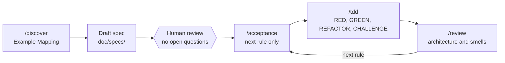

# Cashback Rewards Service

A hexagonal **Spring Boot 4 / Java 25** microservice that rewards customers with cashback on purchases at partner merchants, built with **spec-driven development and AI-assisted TDD** (Claude Code).

> The cashback domain is deliberately small. The point of this repo is the **workflow**: how to get an AI coding agent to produce traceable, tested, architecturally clean code instead of plausible-looking drift.

## Why this exists

AI coding agents skip tests, leak layers, invent requirements and "fix" failing tests by editing them. This project constrains the agent with:

1. **Executable specs**: Example Mapping rules, examples and counter-examples, reviewed by a human before any code.
2. **Custom commands**: `/discover`, `/acceptance`, `/tdd`, `/review`, each with explicit stop gates.
3. **Scoped rules** per layer (domain, persistence, web, test) loaded when the agent edits that layer.
4. **Architecture enforced by tests** (ArchUnit), so boundary violations fail the build instead of relying on review.

## What it does

Customers earn cashback on purchases: `cashback = amount x merchant rate`, **rounded down** to the cent.

| Method | Path | Purpose | Success |
|---|---|---|---|
| POST | `/customers` | Register a customer | 201 |
| POST | `/merchants` | Register a merchant with a cashback rate (%) | 201 |
| POST | `/purchases` | Record a purchase, returns cashback earned | 201 |

```bash
curl -X POST localhost:8080/merchants -H 'Content-Type: application/json' \
  -d '{"displayName":"Acme","legalEntityName":"Acme Ltd","ratePercent":5}'

curl -X POST localhost:8080/purchases -H 'Content-Type: application/json' \
  -d '{"purchaseId":"p-1","customerId":"<id>","merchantId":"<id>","amount":100.00}'
# {"purchaseId":"p-1","cashbackEarned":5.00}
```

## Engineering highlights

- **Hexagonal architecture, enforced.** [ArchitectureTest](src/test/java/com/amrullah/cashback_reward_service/architecture/ArchitectureTest.java) fails the build if the domain touches Spring or JPA, if dependencies point outward, or if inbound and outbound adapters depend on each other.
- **Money is correct by construction.** `BigDecimal` only, explicit `RoundingMode.DOWN`, scale 2. Never `double`.
- **Domain as records and pure Java.** No Lombok, no framework imports in `domain/`.
- **Tests as living specification.** `@Nested` class = spec rule, test method = spec example, names lifted from the spec. Distinct styles per layer: plain JUnit + AssertJ (domain), `@WebMvcTest` (controllers), `@DataJpaTest` (persistence), `@SpringBootTest` + MockMvc (acceptance, `*IT`).
- **Two-loop TDD.** The acceptance test is the outer loop and stays red while inner-loop unit tests drive each production class. A green acceptance test never substitutes for a unit test.

## How it was built: spec-driven development with Claude Code



- Commands: [.claude/commands/](.claude/commands/). Layer rules: [.claude/rules/](.claude/rules/). Project conventions: [CLAUDE.md](CLAUDE.md).
- Worked example of a spec: [basic-cashback-calculation.md](doc/specs/basic-cashback-calculation.md) (9 rules, each with examples and counter-examples).
- **Human gates:** the agent stops after discovery for spec review, works one rule and one cycle at a time, and must propose edge cases for approval rather than silently adding behaviour. It is never allowed to edit a test to make it pass.

### What I learned

- The first `/tdd` produced green acceptance tests with no unit tests. I restructured the command into an explicit outer/inner loop with a per-class "test first" table (commit `5735831`).
- A `/review` pass caught a money assertion that did not use `isEqualByComparingTo` (commit `5764dc3`). Reviewing AI output with a second, differently-prompted pass is worth the cost.
- Rules the agent must follow belong in **checks that fail** (ArchUnit, tests), not only in prose.
- Check detailed handwritten notes here: https://amrullah.github.io/#/page/spec%20driven%20development%20in%20java

## Architecture

```
domain/        pure Java: model/ (Customer, Merchant), service/ (CashbackCalculator)
application/   port/in (use cases), port/out (repositories), service/ (orchestration only)
adapter/in/web/             REST controllers and DTOs
adapter/out/persistence/    JPA entities, repositories, adapters
```

Dependencies flow inward: `adapter -> application -> domain`.

## Run it

Requires Java 25.

```bash
./mvnw spring-boot:run   # start on :8080 (in-memory H2)
./mvnw test              # unit tests
./mvnw verify            # unit + acceptance (*IT) tests
```

## Status and roadmap

Honest state of the work:

- **Done:** customer and merchant registration; purchase recording; cashback calculation, rounded down (spec Rule 1); architecture tests.
- **Specified, not yet built:** Rules 2-9 of the basic cashback spec (minimum purchase, rate validation, registered-customer check, duplicate registration, balance, amount validation, idempotent purchases).
- **Draft specs:** [cashback.md](doc/specs/cashback.md) and [view-account-history.md](doc/specs/view-account-history.md) are exploratory and not scheduled.

Known simplifications, and what I would do for production: in-memory H2 -> PostgreSQL with Flyway; no auth -> OAuth2 resource server; concurrent balance updates -> optimistic locking; add observability (metrics, tracing), OpenAPI contract, and CI.

## Tech stack

Java 25, Spring Boot 4.1, Spring Web / Data JPA / Validation, H2, JUnit 5, AssertJ, ArchUnit, Maven wrapper.

## License

See [LICENSE](LICENSE).
